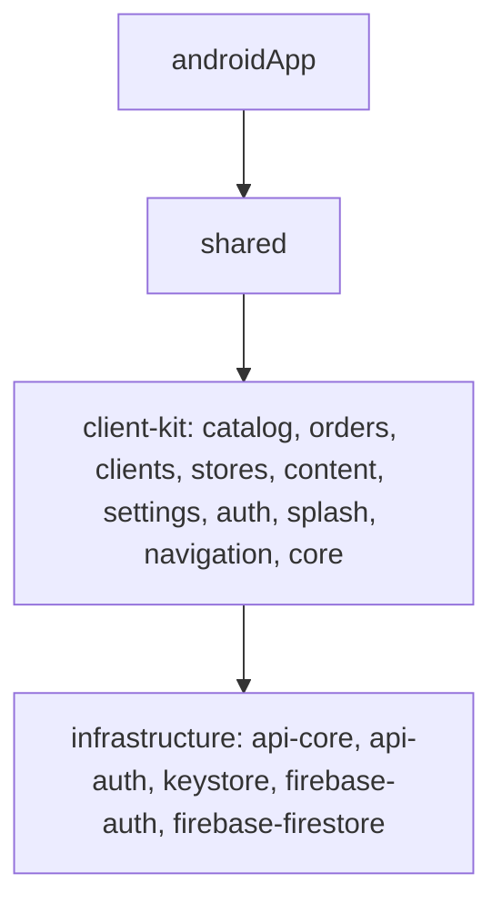

# UGG Store — админ-приложение

Android-приложение для управления интернет-магазином обуви [UGG Store](https://github.com/DinarBes/ugg-client):
каталог, заказы, клиенты, магазины и контент витрины. Данные хранятся в Firebase и сразу появляются
в клиентских приложениях на Android, iOS и Web. Pet-проект.

<!-- Скриншоты: положите картинки в docs/screenshots/ и раскомментируйте строку ниже -->
<!--    -->

## Что умеет

- **Каталог** — товары, цены, остатки
- **Заказы** — список и обработка заказов из клиентского приложения
- **Клиенты** — покупатели и их заказы
- **Магазины** — точки продаж, которые клиенты видят на карте
- **Контент** — что показывается на главной экране клиента
- **Настройки** и вход для администратора

## Архитектура

Та же архитектура, что и у клиента: Kotlin Multiplatform, Clean Architecture + MVVM,
многомодульность по фичам. Каждая фича разбита на `domain`, `data` и `presentation`.



- **build-logic** — convention plugins, общие с клиентом; версии зависимостей в version catalog
- Логика написана в `commonMain`, поэтому при необходимости админку можно собрать и под iOS

## Стек

Kotlin 2.3 · Compose Multiplatform · Material 3 · Coroutines/Flow · Kodein DI · Ktor · Firebase Auth / Firestore · kotlinx.serialization · Kermit

## Запуск

```bash
./gradlew :androidApp:installDebug
```

## Связанные репозитории

- [ugg-client](https://github.com/DinarBes/ugg-client) — KMP-модуль, Android- и Web-клиенты
- [ugg-apple](https://github.com/DinarBes/ugg-apple) — iOS-клиент на SwiftUI

## Автор

Динар Павлов — Android / KMP-разработчик · Telegram [@sapore_mare](https://t.me/sapore_mare)
