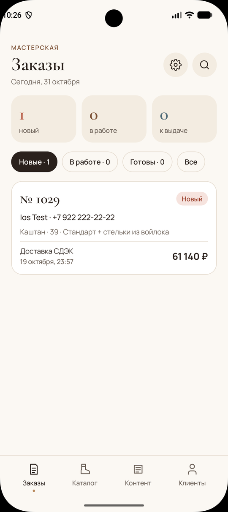
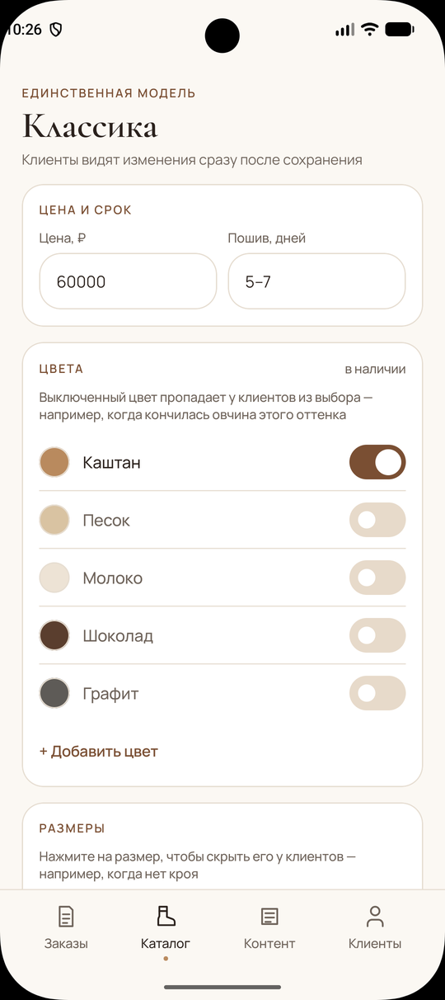
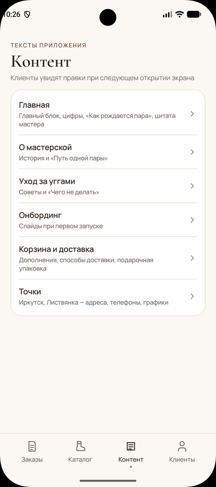
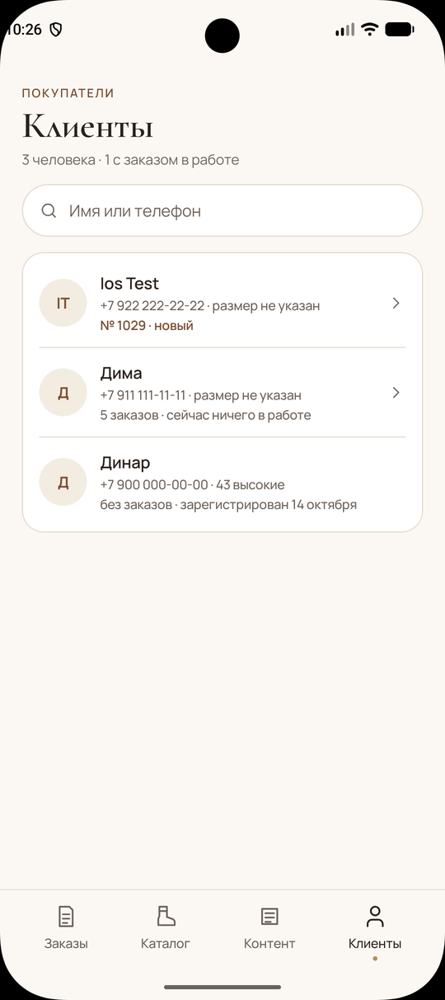
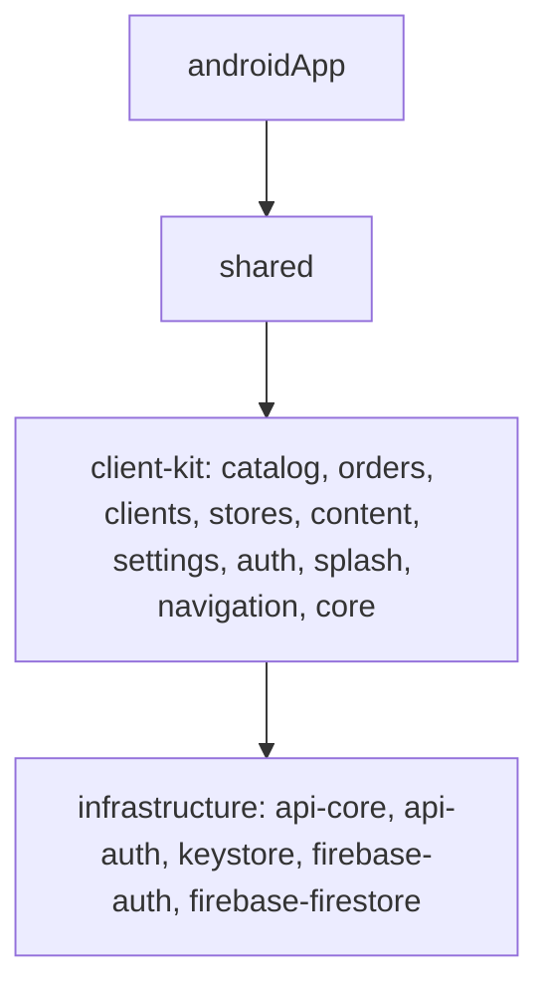

# Байкал — админ-приложение

Android-приложение мастерской «Байкал» для управления [клиентским приложением](https://github.com/DinarBes/ugg-client).
Данные хранятся в Firestore: правки цены, цветов или текстов сразу появляются у клиентов на Android, iOS и Web.
Pet-проект.

   

## Что умеет

- **Заказы** — сводка и фильтр по статусам «новый», «в работе», «к выдаче», поиск
- **Каталог** — цена и срок пошива модели; включение и выключение цветов и размеров, которые видят клиенты
- **Контент** — тексты всех экранов клиента: главная, о мастерской, уход, онбординг, корзина и доставка, точки продаж
- **Клиенты** — покупатели с поиском по имени и телефону, их размер и заказы
- **Настройки** и вход для администратора

## Архитектура

Та же архитектура, что и у клиента: Kotlin Multiplatform, Clean Architecture + MVVM,
многомодульность по фичам. Каждая фича разбита на `domain`, `data` и `presentation`.



- **build-logic** — convention plugins, общие с клиентом; версии зависимостей в version catalog
- Логика написана в `commonMain`, поэтому при необходимости админку можно собрать и под iOS

## Стек

Kotlin 2.3 · Compose Multiplatform · Material 3 · Coroutines/Flow · Kodein DI · Ktor · Firebase Auth / Firestore · kotlinx.serialization · Kermit

## Запуск

```bash
./gradlew :androidApp:installDebug
```

## Связанные репозитории

- [ugg-client](https://github.com/DinarBes/ugg-client) — KMP-модуль, Android- и Web-клиенты
- [ugg-apple](https://github.com/DinarBes/ugg-apple) — iOS-клиент на SwiftUI

## Автор

Динар Павлов — Android / KMP-разработчик · Telegram [@sapore_mare](https://t.me/sapore_mare)
